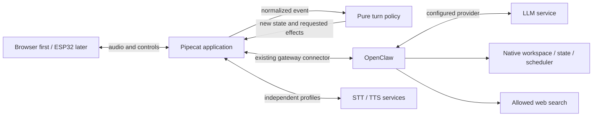
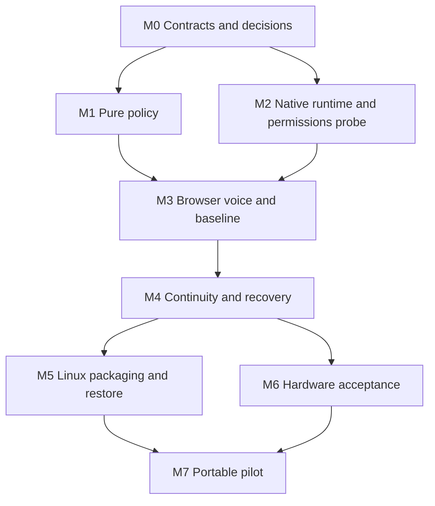

# Sage: a minimal course from specification to working companion

Historical distribution-first course. The owner's correction replaces its
selected-runtime and product-entry decisions with [FUNDAMENTALS.md](FUNDAMENTALS.md).

Planning date: October 13, 2026. Python; browser first, as selected by the owner.
Starting point: three prose documents, one image, no application or test suite.

Read in this order: this course → [source review](RESEARCH.md) →
[first executable contract](TURN-CONTRACT.md) → `tests/test_turn.py` → `sage/turn.py`.
The original [minimum spec](../Open-Companion-Minimum-Spec-v0.1.md) remains the product reference.
This document proposes a tighter execution order; it does not silently replace that spec.

## 1. What we are building

One owner talks to one persistent companion from a browser, then a supported ESP32 board.
The companion can explicitly save/retrieve/remove a note, create/list/cancel a reminder,
and answer a question with web sources. The owner controls capture, playback, and tasks.
Provider changes preserve identity and durable state.

The first useful proof is narrower: one browser turn reaches the existing agent,
speaks an answer, and stops correctly. A deterministic simulation is preparation for
that proof, not evidence that voice, memory, or the upstream integration works.

Sage's broader “real-world OS” idea in SAGE.MD describes responsibility areas.
For this release it is a product hypothesis, not a requirement to write an OS,
a new agent runtime, or six separate services.

## 2. The functional foundation

A pure function calculates an answer from supplied values and has no observable
side effects. Immutable state means a transition returns a new value; it does not
change the value another caller is holding. Effects are actions such as starting
capture, calling a model, writing a note, and playing audio.

Our central rule is:

```text
transition(old_state, event) → (new_state, requested_effects)
```

The function requests an action; an outer adapter executes it and reports what
actually happened as another event. An action request is not proof of success.
For example, a send request means “working”; actual playback means “speaking”.
Stop requests local silence before remote cancellation. A cancellation request
does not prove that a completed note or reminder was undone.

This follows the [functional core / imperative shell approach](https://www.destroyallsoftware.com/screencasts/catalog/functional-core-imperative-shell).
Python does not enforce functional programming. We enforce it by keeping the
core free of clocks, randomness, network calls, filesystem access, and globals.
The shell supplies IDs and time. Frozen dataclasses and tuples are sufficient;
we do not need monads, a functional library, or a generic effects framework.

LLM sampling and external APIs belong in the shell. A model can vary while our
admission, authorization, stopping, and recovery rules remain deterministic.
Test exact state transitions and tool outcomes, not exact model prose.

## 3. Boundaries and ownership



The diagram shows runtime communication. Source dependencies point inward:
adapters import the core; the core never imports Pipecat or OpenClaw.

| Boundary | Owns | Must not own | Verification |
| --- | --- | --- | --- |
| Presentation | Capture controls, accessible status, playback, source links | Provider secrets; authority based on animation | Browser/device checks |
| Pure policy (`sage/turn.py` now) | Valid transitions, correlation of turns, effect ordering | I/O, persistent agent memory, model logic | Fast deterministic tests |
| Pipecat shell (next) | Serialized event handling, media, connector calls, effect failures | A second scheduler or source of durable memory | Adapter contracts + live smoke |
| OpenClaw | Agent identity, session history, notes, tool policy, scheduling | Trusting model text to grant permissions | Restricted real-runtime tests |
| Release package (later) | Pins, host setup, credentials, state volumes, restore procedure | “latest” dependencies or shareable personal backups | Fresh-host acceptance |

These are modules/process boundaries justified by existing ownership. They are
not five new frameworks. Add adapter files only when a real integration needs them.

Use one stable agent ID and deliberate conversation key. A socket ID identifies
a connection; a local turn ID correlates callbacks; a gateway run ID identifies
work; none replaces the companion's identity. Test cases use isolated workspaces
and session keys. Serializing events in one application does not prevent the
native Control UI from sending concurrently; the product's active-voice admission
and shared-conversation behavior need a real integration test.

## 4. What changes in the original build order

Keep the existing components as provisional defaults. Move permission, memory,
and disconnect probes ahead of firmware. A voice demo with unrestricted file
tools would not establish the proposed minimum contract.

The source review identifies five concrete gaps:

1. Native recall tools do not by themselves establish restricted note CRUD.
   First try native policy plus a bounded notes workspace. If it cannot confine
   writes or prevent changes to persona/config, use a small runtime-local note
   tool with fixed paths and validated IDs. Do not add a second memory database
   or grant arbitrary file tools just to pass the demonstration.
2. Current memory defaults include background consolidation. Explicit-only
   saving requires disabling applicable consolidation, flush, ingestion, and
   hooks on the actual pinned version, then checking observable writes.
3. Stream failure is not tool failure. Reconcile a write using recorded evidence
   or report “unknown”; never automatically resubmit an uncertain turn.
4. Six display states are insufficient to describe a task's outcome. Keep
   transport, capture, playback, and run status separate; derive the display.
5. One conversation, two endpoints, and one voice admission are distinct rules.
   A browser text send must not accidentally interrupt a device voice run.

See [RESEARCH.md](RESEARCH.md) for evidence, qualifications, and comparisons.

## 5. Document-driven and test-driven loop

For each slice, use this sequence:

1. Write a short contract: trigger, inputs, output, owner, failure behavior,
   and one acceptance example. Associate it with P1–P11 from the product spec.
2. Write the smallest behavioral test that fails for the missing behavior.
   Run it and record why it fails; an import failure proves only absence.
3. Implement enough to pass. For later increments, seek a behavioral failure.
4. Refactor only if duplication obscures the contract; run the focused suite.
5. Run the relevant real boundary check. A mock cannot prove gateway auth,
   microphone capture, storage durability, or model tool compatibility.
6. Update the evidence record and explain the result in plain language.

Keep three kinds of truth distinct: product requirements (original spec),
implementation contracts (small documents), and execution evidence (dated results).
Change a contract and its tests together when a requirement changes. Do not copy
upstream documentation into the repo or turn every implementation detail into an ADR.
Record an ADR only for a consequential choice or a failed gate that changes the plan.

## 6. Milestones and test gates

Effort bands below are planning estimates for one developer in focused hours,
not promised elapsed times. Credentials, downloads, hardware, and upstream fixes
can add waiting time. Re-estimate after the first live integration.

| Gate | Depends on | Deliverable and exit evidence | Effort band | Product coverage |
| --- | --- | --- | --- | --- |
| M0: contract | Nothing | Architecture, critique, dependency chart, first contract; explain one turn and one uncertain write | 2–4 h | Design only |
| M1: pure turn policy | M0 | Tested capture/stop/display/disconnect transitions; stale callbacks ignored; no automatic replay | 2–4 h | Parts of P2/P3/P10, unit evidence only |
| M2: real runtime probe | M0; M1 may proceed alongside | Connector handshake, text run, abort, same-session second run; restricted note create/list/read/delete; restart persistence; one reminder CRUD; disconnect outcome probe; exact compatible versions recorded | 4–12 h | Integration portions of P4/P7/P8/P10 |
| M3: browser voice | M1 + successful M2 | Existing Pipecat browser client; press-to-talk; correct states; stop; 30-turn latency baseline; second voice session rejected | 8–16 h | Browser P1/P2/P3; baseline P6 |
| M4: continuity and recovery | M3 | Durable receipt/status handling if native records are insufficient; restart and fault injection; two hosted LLMs + local endpoint; alternative speech profile; active-recall deletion checks; browser handoff | 8–20 h | P1/P4/P5/P6/P7/P8/P10 |
| M5: Linux release proof | M4 | Fresh install, restricted tool inventory, revocable endpoint credential, safe template, verified restore to fresh instance, resource/cost report | 6–12 h | P8/P9/P11 |
| M6: CoreS3 local proof | M3 + M4 contracts; release requires M5 | Pinned upstream firmware, six states, controls, real capture/stop timing, revoke/disconnect tests, power measurements | 8–20 h | Device P1/P2/P3/P8 |
| M7: portable pilot | M5 + M6 | Hotspot + forced relay test, noisy samples, measured battery behavior, accurate offline reminder status; all v0.1 gates closed | 6–12 h | Cross-network acceptance |

Total initial engineering envelope: roughly 44–100 focused hours. It is not a
confidence interval. Do not use it as a delivery commitment before M2 establishes
compatibility and the restricted-note path.

M2 fails closed: no confirmed handshake → investigate pinned connector or the
existing HTTP route; no bounded note permissions → resolve the note boundary;
no terminal evidence after a disconnect → retain unknown. Reconsider the runtime
only after documenting a concrete failed requirement, not because a rewrite feels cleaner.

## 7. What is sequential and what can run in parallel



The critical path to a browser proof is M0 → M2 → M3, with M1 joining at M3.
The critical path to v0.1 closes both M5 and M6 before M7.

| Work that can overlap | Preconditions | Keep serialized |
| --- | --- | --- |
| M1 pure tests + M2 source/runtime probe | M0 event vocabulary agreed | Changes to the shared event contract |
| Browser client controls + media adapter | M2 connector proven; M1 contract fixed | Their integration and stop measurement |
| Provider profiles + speech profile comparison | Baseline voice works; isolated sessions/workspaces | Mutations in a shared agent workspace |
| Packaging docs + upstream firmware compile | Working versions available | Release pin changes and acceptance |
| M5 fresh-host proof + M6 device checks | M4 contracts stable | Final release result and shared gateway runs |

A single owner conversation is intentionally serial. Capture, network I/O,
audio synthesis, and playback can overlap as Pipecat supports them, but state
events need one ordered reducer queue. Cancellation must take priority over
queued speech. Limit concurrency rather than starting a task per callback.
This chart identifies opportunities; no parallel agents are needed for the
first slice, and no speculative modules are created for future teams.

## 8. Speed: two different measurements

Engineering feedback targets, initially proposed: core suite under one second;
local adapter tests under ten seconds; pinned-runtime smoke under two minutes
once services are running. Measure them separately from dependency installation.
Run cheap checks on each edit; paid/provider and hardware suites at their gates.

Voice timestamps: press, release/end of speech, final STT result, gateway send,
first meaningful reply text, TTS audio ready, first useful audio played, stop press,
audio silence, cancellation request, cancellation evidence. Use monotonic time
for durations; use UTC timestamps and the owner's IANA timezone for reminders.
Do not subtract unsynchronized host and device clocks to claim latency.

```text
end-of-speech → useful speech
  = final-STT delay + agent useful-output delay
    + speech buffering/synthesis delay + transport/playback delay
```

Stages may overlap; record timestamps rather than assuming their costs add
without overlap. A filler such as “Let me check” is not a useful answer.
For 30 successful turns, report median and nearest-rank p95 (the 29th ordered
sample), along with failures, network, model, speech profile, host, and sample set.
Thirty samples are a smoke/baseline, not a stable tail-latency estimate.
Collect a larger repeated sample before claiming dependable p95.

Keep the spec's proposed median ≤2 s, p95 ≤4 s, and local stop ≤250 ms.
Measure before optimizing. If latency misses, locate the expensive stage; test
bounded sentence streaming next if buffering dominates. Never sacrifice truthful
write outcomes or stop behavior to improve first-audio numbers.

## 9. Acceptance details that must be decided before their slice

| Scenario | Required clarification / test |
| --- | --- |
| Remember a note | Confirm explicit save with a stable ID; verify stored content directly, then recall separately |
| Delete a note | Remove active file/index/context references; test a new session and current session; document transcripts/backups that remain |
| Reminder | One-shot absolute time first; echo date and timezone; reject past/ambiguous times; record job ID; distinguish fired from delivered |
| Host asleep | Declare no on-time execution; verify pinned scheduler's catch-up policy on restart rather than inventing one |
| Disconnect during write | Check recorded job/note/run evidence; no evidence means unknown, not failed; do not repeat automatically |
| Host restart during write | Persist required correlation/receipt before dispatch if native runtime evidence cannot recover it; test crash windows |
| Provider switch | Switch only between turns; keep identity, workspace, conversation key; validate tool results independently of prose |
| Credentials | Host holds gateway/provider keys; endpoint has revocable, limited credential; protect signaling and data controls |
| Search answer | Retain links in browser; untrusted search text cannot enable tools; include negative permission tests |
| Restore | Test the actual pinned runtime; disable external reminder delivery on the restore target until ownership transfers |

## 10. Execution record

M0 documents are written. M1 implementation and deterministic tests are the first
execution slice. Their measured result is recorded in [EVIDENCE.md](EVIDENCE.md).
M2 authentication passed on the disposable macOS setup and in the packaged Linux
ARM64 containers; its remaining runtime/tool scenarios are pending. M5's local
packaging subset now passes boot, authentication, and basic volume persistence;
full release acceptance remains pending. See [PACKAGING.md](PACKAGING.md).

Next concrete work: choose/configure a test model provider for the disposable
gateway, then finish M2's actual send/abort, restricted note, reminder, restart,
and disconnect checks. [The probe runbook](GATEWAY-PROBE.md) records the working
handshake setup. Secrets stay outside this repo.

Deferred: custom PCB, full builder UI, always-on capture, automatic memory
consolidation, custom agent runtime, new scheduler/database, universal provider
adapters, cross-runtime export, marketplace, multi-tenant hosting, and a custom
browser framework. These do not help establish the first contract.
